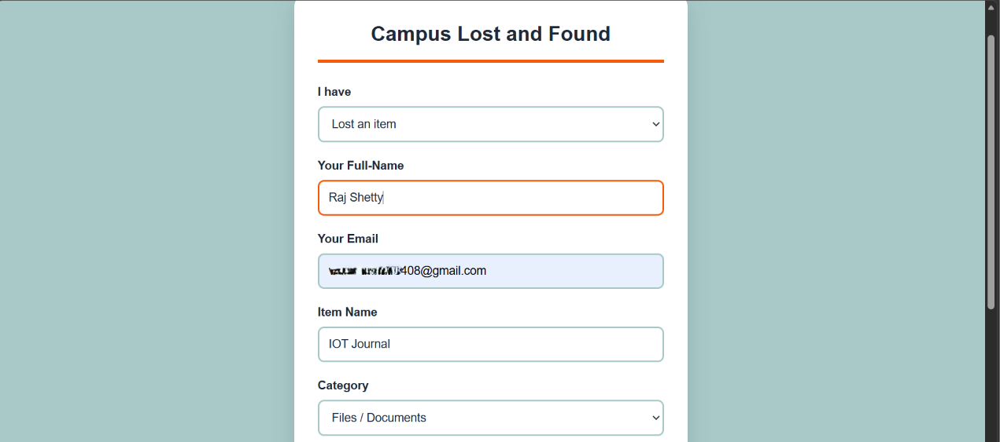
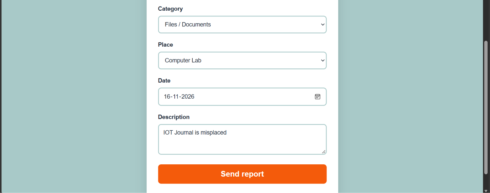
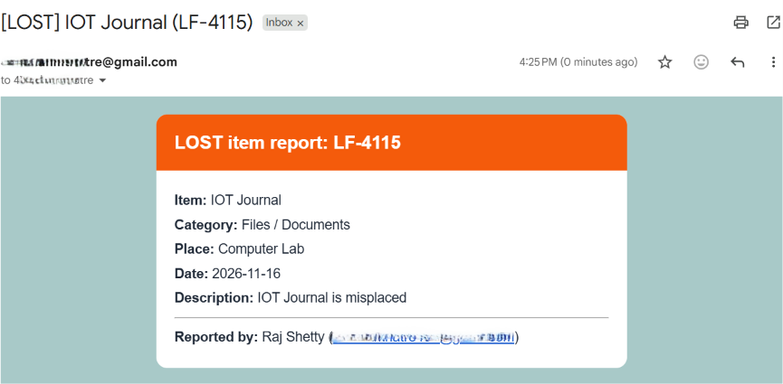
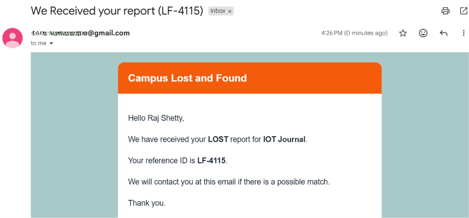

# Campus Lost & Found Portal

A lightweight, stateless **Java Spring Boot** web application that acts as an automated "Form-to-Email" routing system for campus lost and found reports. Designed with **zero database dependencies**, it leverages backend Thymeleaf email templating and Spring Mail to instantly process submissions and dispatch formatted HTML emails.

## 📸 Application Screenshots

### 1. Frontend Submission Form
<p align="center">
  
  
</p>

### 2. Automated HTML Emails
**Admin Notification Ticket (`emailadmin.png`)**


**User Confirmation Receipt (`email2.png`)**


---

## 🚀 Key Features

* **Dual-Email Dispatch Pattern:** Automatically generates two distinct emails per form submission:
  1. A detailed routing ticket sent to the department admin (with user reply-to headers).
  2. A clean, branded confirmation receipt sent back to the user with a unique Reference ID (e.g., `LF-4829`).
* **Dynamic HTML Templating:** Uses **Thymeleaf** to compile dynamic backend variables into professional, responsive HTML email layouts.
* **Smart In-Memory Rate Limiting:** Prevents spam and duplicate submissions by tracking recent reports in a thread-safe cache (`ConcurrentHashMap`) with automatic expiration (`24-hour window`).
* **Stateless & Database-Free:** Runs completely in-memory, making it lightweight, fast, and easy for anyone to clone and run locally within seconds.
* **Responsive Frontend:** Clean HTML/CSS/JS interface with dynamic form field toggling (e.g., revealing collection point inputs only when "Found" is selected).

---

## 🛠️ Tech Stack

* **Backend:** Java 17, Spring Boot, Spring Web, Thymeleaf, Spring Mail (`JavaMailSender`)
* **Frontend:** HTML5, CSS3, Vanilla JavaScript (Fetch API)
* **Build Tool:** Maven

---

## ⚙️ Getting Started Locally

### 1. Clone the Repository
```bash
git clone [https://github.com/YOUR_USERNAME/YOUR_REPOSITORY_NAME.git](https://github.com/YOUR_USERNAME/YOUR_REPOSITORY_NAME.git)
cd Campus-Lost-Found

### 2. Configure Email Credentials
```bash
spring.mail.host=smtp.gmail.com
spring.mail.port=587
spring.mail.username=your-email@gmail.com
spring.mail.password=your-gmail-app-password

lostfound.admin.email=admin-recipient@gmail.com

### 3. Run the Application
```bash
mvn spring-boot:run
